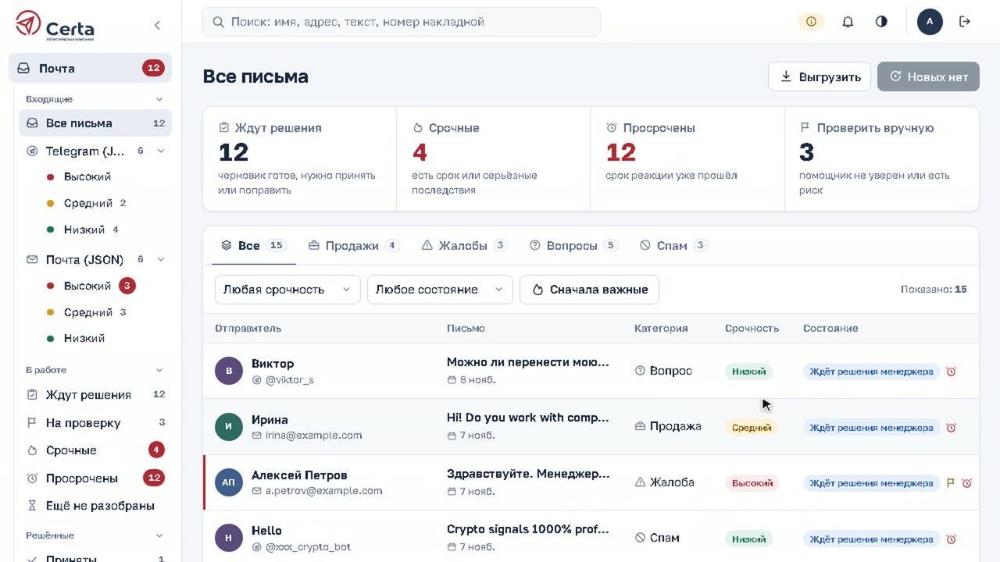
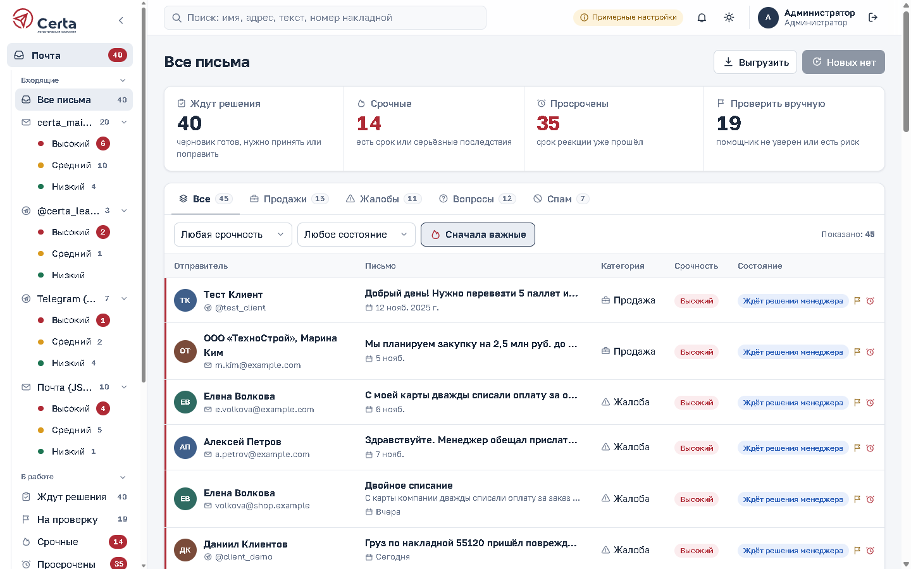
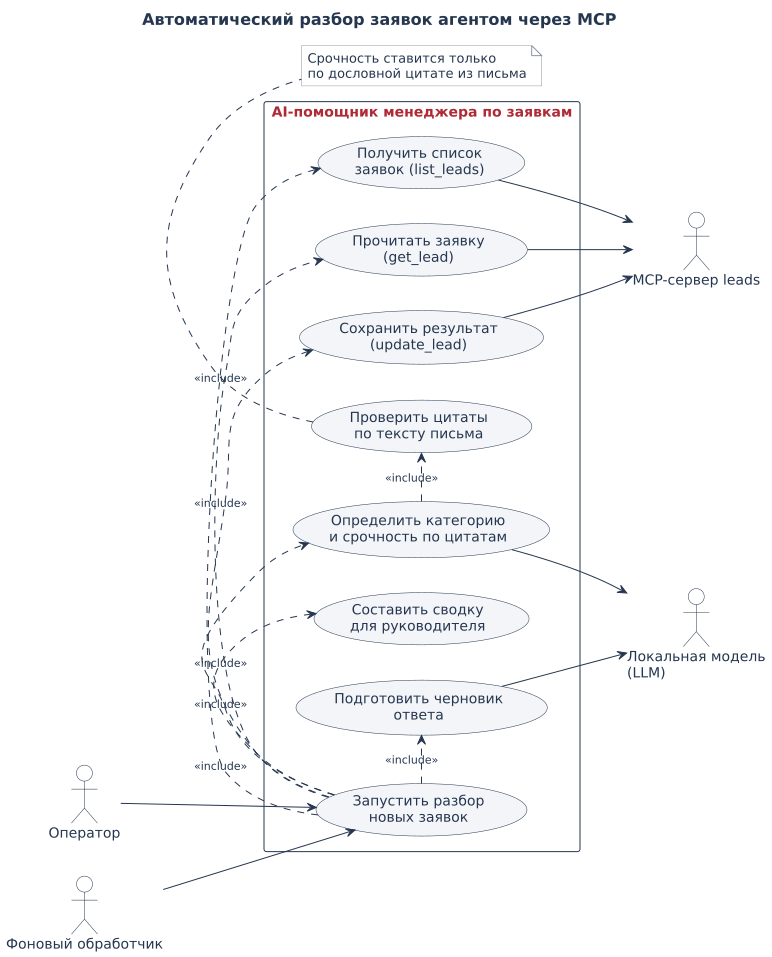
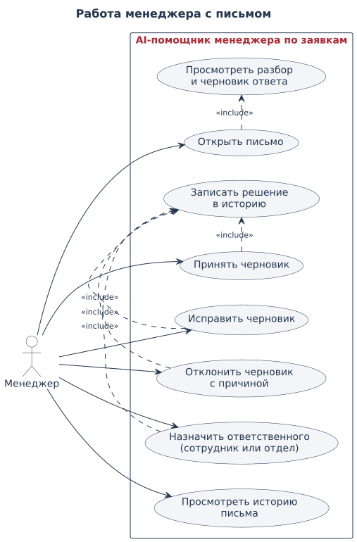
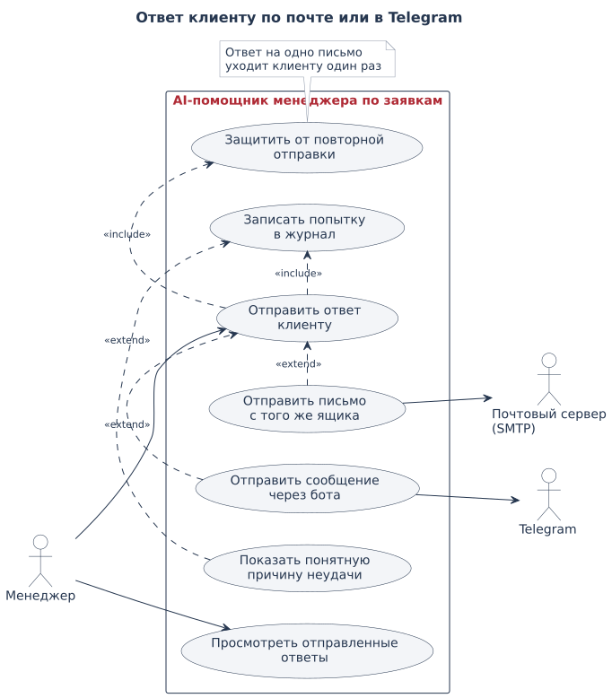

# Certa · AI-помощник менеджера по заявкам

Менеджеры логистической компании разбирали заявки из почты и Telegram вручную: что это за
обращение, насколько оно срочное, какой ответ написать. Теперь это делает AI-агент, а менеджер
только проверяет результат и нажимает «Отправить».

- **Часть 1 задания — MCP-сервер** над `leads.json`: `list_leads` (с фильтром по статусу),
  `get_lead(id)`, `update_lead(id, category, priority, status, draft_reply)`.
- **Часть 2 — агент** по одной команде «обработай новые заявки»: читает `new` через MCP,
  определяет категорию (`sale` / `complaint` / `question` / `spam`) и приоритет
  (`high` / `medium` / `low`), пишет черновик (у спама — нет), сохраняет `processed` через
  `update_lead` и выдаёт сводку руководителю.
- **Часть 3 — этот README**: запуск, решения, где агент ошибается, что нужно для настоящей CRM.

Сверх задания — рабочее место менеджера «Почта Certa»: приём писем из любого числа почтовых
ящиков и Telegram-ботов, очередь проверки, ответ клиенту из окна письма, база знаний, роли,
обучение по кнопкам, выгрузка, Docker. Модель — бесплатная локальная (Qwen3 через llama.cpp),
данные клиентов никуда не уходят; Claude Code тоже подключается к тому же MCP-серверу.

| | |
|---|---|
| Код | [`lead-assistant/`](lead-assistant/) — Python 3.12 (MCP, агент, API), Vue 3 + TypeScript (интерфейс) |
| Комплект сдачи | [`release/`](release/) — обработанный `leads.json`, скриншоты, диалоги с ИИ, отчёт проверки, архив |
| Версия | 2.1.0 · 244 автотеста · ruff, mypy strict, vue-tsc — без замечаний |
| Лендинг | **[sitebypro.ru/certa](https://sitebypro.ru/certa/)** · исходники в [`landing/`](landing/) |
| Видео | [видеоинструкция, 3:14](video/certa-instrukciya.mp4) · [субтитры](video/certa-instrukciya.srt) |

## Видео и лендинг

[](video/certa-instrukciya.mp4)

**[Видеоинструкция](video/certa-instrukciya.mp4)** (3:14, со звуком, [субтитры](video/certa-instrukciya.srt)).
В ролике показано, как помощник читает письма из почты и Telegram, определяет тему и
срочность, готовит черновик, а менеджер проверяет и отправляет ответ.

**[Лендинг](https://sitebypro.ru/certa/)** — одна страница о проекте. На ней девять
коротких роликов: разбор заявки, локальная модель, три MCP-инструмента, проверки кодом,
надёжная запись, рабочее место, почта и Telegram, качество в цифрах. Там же встроена
видеоинструкция. Локально страница открывается из [`landing/index.html`](landing/index.html).
Ролики лежат в [`landing/media/`](landing/media/), что в каком из них — в
[`landing/media/README.md`](landing/media/README.md).

Видео пересобирается скриптами из [`video/`](video/): `make_video.py` собирает полную
инструкцию, `clips.py` и `scenes.html` — ролики для лендинга.

## Содержание

1. [Быстрая проверка задания за 5 минут](#быстрая-проверка-задания-за-5-минут)
2. [Возможности](#возможности)
3. [Запуск](#запуск)
4. [Как пользоваться](#как-пользоваться)
5. [Архитектура](#архитектура)
6. [Иерархия файлов и функций](#иерархия-файлов-и-функций)
7. [Диаграммы вариантов использования (UML)](#диаграммы-вариантов-использования-uml)
8. [HTTP API](#http-api)
9. [Какие решения приняты и почему](#какие-решения-приняты-и-почему)
10. [Где агент может ошибиться и как это заметить](#где-агент-может-ошибиться-и-как-это-заметить)
11. [Эксплуатация](#эксплуатация)
12. [Проверка качества](#проверка-качества)
13. [Что добавить для настоящей CRM](#что-добавить-для-настоящей-crm)
14. [Комплект сдачи](#комплект-сдачи)

---

## Быстрая проверка задания за 5 минут

**Вариант А — Claude Code (без скачивания модели).** Откройте папку `lead-assistant` в Claude Code:
проектный `.mcp.json` подключит MCP-сервер `leads`, `CLAUDE.md` — правила агента. Введите
`/process-leads` или «обработай новые заявки». Модель сама увидит три инструмента и вызовет их
([скриншот](release/screenshots/17_claude_code_mcp_tools.png), полный диалог —
[`release/dialogs/claude-code-demo-session.zip`](release/dialogs/)).

```bash
cd lead-assistant
bash scripts/install.sh          # окружение и зависимости (Windows: то же в Git Bash)
claude                           # затем: /process-leads
```

**Вариант Б — одна команда на локальной модели.**

```bash
cd lead-assistant
bash scripts/install.sh
.venv/bin/process-leads          # Windows: .venv/Scripts/process-leads
```

Первый запуск предложит модель по объёму памяти (`qwen3-4b` / `8b` / `14b`), скачает её и
llama.cpp с проверкой SHA-256. Результат пишется в `data/leads.json`, сводка печатается в
терминал ([скриншот](release/screenshots/16_agent_one_command_mcp.png)), трейс каждого вызова
MCP — в `runs/<run_id>/`. Уже обработанное не перезаписывается: повторный запуск ничего не меняет.

**Готовый результат**: [`release/leads.processed.json`](release/leads.processed.json) — 15 заявок,
все `processed`, у спама `draft_reply: null`. Повторный прогон на чистом файле даёт те же
категории и приоритеты ([`release/evidence/agent-run/`](release/evidence/agent-run/)).

## Возможности

| Область | Что умеет |
|---|---|
| Агент | Разбор через три MCP-инструмента; категория и приоритет выводятся кодом из дословных цитат модели; черновик проверяется на обещания и факты не из письма; сводка руководителю |
| Почта | Любое число почтовых ящиков (IMAP) и Telegram-ботов у каждого сотрудника; проверка раз в минуту; импорт без дублей; HTML-письма, кодировки, русские папки IMAP |
| Рабочее место | Папки по ящикам со срочностью, «В работе», «Решённые»; сводка-фильтры; вкладки категорий; поиск; «Сначала важные»; окно письма; выгрузка в Excel / PDF / Word / JSON |
| Решения | Принять / исправить / отклонить черновик (привязано к версии результата), назначить ответственного из сотрудников или отдел, история |
| Ответ клиенту | По почте — с того ящика, куда пришло письмо (SMTP, в той же переписке); в Telegram — от того же бота; защита от повторной отправки, журнал попыток |
| Очередь проверки | Срочные, жалобы, противоречия, неуверенность агента, обязательства в черновике; срок реакции по рабочему календарю |
| База знаний | TXT / MD / PDF, поиск FTS5, права по роли и срок действия; фрагменты источников в окне письма; 10 документов-образцов |
| Роли | Менеджер, руководитель, администратор — каждому только нужные разделы и настройки |
| Интерфейс | Дизайн под логотип Certa, светлая и тёмная тема, от телефона до 5000 px, сворачиваемая панель, звук и системные уведомления о новых письмах, обучение по кнопкам |
| Эксплуатация | Docker (CPU и NVIDIA), фоновый обработчик с повтором и восстановлением, резервные копии, диагностика |

## Запуск

### Docker — любая машина

```bash
cd lead-assistant
cp .env.example .env                       # при желании: почта и бот администратора
docker compose up -d                       # процессор, Qwen3-8B
docker compose -f docker-compose.yml -f docker-compose.gpu.yml up -d   # NVIDIA, Qwen3-14B
docker compose exec web cat /data/initial-admin.txt                      # начальный пароль admin
```

Адрес — `http://127.0.0.1:8000`. Первый запуск скачивает модель в том `leads-llm` (5 ГБ для 8B,
9 ГБ для 14B) и поднимает контейнеры `model` → `llm` → `web` → `worker`. Пересоздание контейнеров
данные не трогает: они в томе `leads-data`.

### Без Docker

```bash
cd lead-assistant
bash start.sh          # окружение, модель, интерфейс и обработчик; остановка — bash stop.sh
```

### Сервер Ubuntu

```bash
apt update && apt install -y docker.io docker-compose-v2 git
git clone https://github.com/danielgreen229/CERTA-MAIL.git /opt/certa && cd /opt/certa/lead-assistant
nano .env              # см. ниже
docker compose up -d
```

Почта и Telegram-бот из `.env` подключаются при первом запуске, проверяются и принадлежат
администратору — остальные ящики и боты сотрудники добавляют сами в «Почта и сервисы»:

```
LEADS_PUBLISH=127.0.0.1:8000
LEADS_EMAIL_HOST=imap.mail.ru
LEADS_EMAIL_PORT=993
LEADS_EMAIL_USER=leads@example.ru
LEADS_EMAIL_FOLDER=INBOX
LEADS_EMAIL_PASSWORD=пароль-для-внешнего-приложения
LEADS_TELEGRAM_BOT_TOKEN=токен-от-BotFather
```

Наружу порт не открывайте: доступ через SSH-туннель
(`ssh -L 8000:127.0.0.1:8000 root@сервер`) или обратный прокси с HTTPS
(Caddy: `mail.example.ru { reverse_proxy 127.0.0.1:8000 }`).

### Требования

| Вариант | Память | Скорость разбора 15 заявок |
|---|---|---|
| CPU, `qwen3-8b` | от 12 ГБ ОЗУ | 30–60 мин на 8–16 vCPU, в фоне |
| CPU, `qwen3-4b` | от 8 ГБ ОЗУ | быстрее, точность ниже |
| NVIDIA, `qwen3-14b` | ~11 ГБ видеопамяти | ~2,5 мин |

Любой OpenAI-совместимый сервер (Ollama, LM Studio, облако) — через `LEADS_LLM_URL`.

## Как пользоваться

При первом входе внизу появляется окно «Пройти обучение?». Тур из 25+ шагов подсвечивает каждую
кнопку и объясняет её: папки и срочность, сводку, фильтры, «Сначала важные», поиск, окно письма,
решения, ответ клиенту, выгрузку, звук и тему, панель, разделы. Отметка о прохождении хранится в
браузере (`localStorage`); пройти заново — «Настройки» → «Пройти обучение заново». Шаги зависят
от роли: администратор дополнительно видит раздел своих настроек.

Обычный день менеджера:

1. «Почта» → «Сначала важные»: наверху срочные и просроченные письма.
2. Открыть письмо: текст клиента, что понял помощник, оценка и её основание-цитата, «Проверьте сами».
3. «Принять» — черновик верный, «Исправить» — категория / срочность / текст, «Отклонить» — с причиной.
4. Поправить ответ в поле «Ответ клиенту» и нажать «Отправить ответ».



## Архитектура

```
 браузер ──HTTP──▶ web (Starlette, leads-web) ──┐  общий слой  ┌── leads.json  (источник истины)
                    раздаёт собранный Vue        ├────────────▶ ├── app.db      (SQLite: служебное)
 оператор ─▶ process-leads / Claude Code ──MCP──▶ server.py    └── uploads/    (база знаний)
 worker (leads-worker) ─ задачи из SQLite ─▶ раннер ─▶ агент ─MCP(stdio)─▶ server.py
                       └ раз в минуту: IMAP / Telegram ─▶ импорт   └─HTTP─▶ llama.cpp (Qwen3)
 менеджер ─▶ «Отправить ответ» ─▶ outbox ─▶ SMTP ящика / Telegram Bot API
```

| Хранилище | Что лежит | Кто пишет |
|---|---|---|
| `leads.json` | Заявки и результат агента (`category`, `priority`, `status`, `draft_reply`) | только `update_lead` через общий слой; импорт — добавлением в конец |
| `app.db` (SQLite, WAL) | пользователи и сессии, задачи, версии результата, решения, назначения, аудит, база знаний, подключения, исходящие ответы, настройки | API и обработчик |
| `runs/<run_id>/` | `run.json` (метрики, сверка), трейсы вызовов MCP, сводка | раннер |
| `uploads/` | документы базы знаний | API |

**Согласованность.** Запись в `leads.json` — под межпроцессной блокировкой, с перечитыванием и
атомарной заменой; повтор с теми же значениями → `unchanged`, другие значения → `CONFLICT`.
Решение менеджера не меняет `leads.json`: оно хранится в SQLite и привязано к версии результата
(хеш категории, приоритета и черновика). Импорт хранит внешний ID и в заявке (`source_id`), и в
SQLite — повтор после сбоя между записями отсекается. Обработчик отмечает задачу каждые 3 с;
задача без отметки 90 с возвращается в очередь (до 3 попыток).

**Границы доверия.** Текст писем и документов — данные, не указания. Агент видит только три
инструмента; категорию и приоритет выводит код по подтверждённым цитатам; черновик с обещаниями и
числами не из письма сервер не записывает. Права проверяются в API; изменяющие запросы требуют
сессию (`HttpOnly`, `SameSite=Strict`) и заголовок приложения. Секреты в ответах маскируются.

## Иерархия файлов и функций

```
CERTA-MAIL/
├── README.md                      этот файл
├── release/                       комплект сдачи (см. последний раздел)
└── lead-assistant/
    ├── .mcp.json                  MCP-сервер leads для Claude Code
    ├── CLAUDE.md                  правила агента для Claude Code (подключает rules.md)
    ├── .claude/commands/process-leads.md   команда /process-leads
    ├── data/leads.original.json   исходные 15 заявок из задания
    ├── docker-compose.yml, docker-compose.gpu.yml, Dockerfile, start.sh, stop.sh, .env.example
    ├── pyproject.toml, requirements*.lock          зависимости с хешами
    ├── docs/
    │   ├── diagrams/              12 UML-диаграмм (PlantUML + SVG)
    │   └── kb/                    10 документов-образцов базы знаний
    ├── evals/                     наборы для оценки качества агента
    ├── scripts/                   установка, проверки, приёмка, выпуск архива
    ├── src/lead_assistant/        Python: MCP, агент, рабочее место (ниже)
    ├── tests/                     244 автотеста
    └── web/                       интерфейс: Vue 3 + TypeScript (ниже)
```

### `src/lead_assistant/` — MCP-сервер и агент

| Файл | Назначение и ключевые функции |
|---|---|
| `server.py` | **MCP-сервер (stdio)**. `build_server` — три инструмента поверх хранилища; `resolve_leads_path` — путь к JSON; `main` (`leads-mcp-server`) |
| `storage.py` | **Хранилище `leads.json`**. `LeadStore` (`list_leads`, `get_lead`, `update_lead`, `append_leads`, `snapshot`); `Snapshot`, `UpdateResult`; `parse_leads`, `serialize_leads`, `detect_style`/`FileStyle` — запись без изменения нетронутых строк; `find_lead` — поиск с учётом типа ID; `sha256_hex` |
| `locking.py` | `exclusive_lock` — межпроцессная блокировка через lock-файл |
| `models.py` | Предметная модель: `ErrorCode`, `LeadError`; `LeadUpdate`, `validate_update` — проверка параметров `update_lead`; `is_valid_lead_id` |
| `service.py` | **Общий слой MCP и API**: `record_result` — проверка черновика и запись; `validate_correction`/`Correction` — правка менеджера по тем же правилам |
| `draft_policy.py` | Проверка черновика: `check_draft` — утверждения не из письма; `lead_numbers` — числа заявки; `detect_language` |
| `rules.md`, `rules.py` | Правила агента (одни для CLI и Claude Code); `load_rules`/`Rules`, `operator_prompt` |
| `decision.py` | **Категория и приоритет по фактам**. `analysis_request` — вопросы к модели с требованием цитат; `decide` → `Decision`; `is_grounded`, `supports` — цитата есть в письме и говорит о последствии; срок по календарю («на следующей неделе» не раньше понедельника) |
| `extract.py` | Детерминированный логистический разбор: `extract` → `Extraction`/`Found` (маршрут, груз, вес, объём, даты, номера, контакт); `extract_dates` — относительные даты от даты письма; `missing_for` — чего не хватает |
| `agent.py` | Общие типы агента: `ToolCall`, `AgentRequest`, `AgentOutcome`, `AgentBackend`; `ClaudeSdkBackend`; `parse_tool_payload`, `summarize_arguments`, `apply_tool_result`, `check_init`, `mcp_server_command` |
| `local_backend.py` | Агент на OpenAI-совместимой модели: `LocalLlmBackend`; `openai_tools`, `report_schema`, `write_instruction`; `LlmError`, `McpCallError` |
| `llm.py` | Локальная модель: `ModelSpec`, `Artifact`, `recommended_model`, `download` (докачка + SHA-256), `ensure_server`, `ensure_model`, `LlamaServer`, `local_server`, `LlmSetupError` |
| `backends.py` | Выбор модели: `BackendOptions`, `add_backend_arguments`, `options_from_args`, `choose_interactively`, `load_saved`/`save_choice`, `open_backend`, `use_utf8_console` |
| `runner.py` | **Прогон**: `run_processing` → `run.json`; `RunConfig`, `exit_code`, `error_layer`, `combine_results`, `tool_metrics`, `usage_metrics`, `new_run_id` |
| `reconcile.py` | Независимая сверка: `reconcile` (учёт по ID), `check_integrity`, `check_processed_shape`, `parse_model_report`, `merge_reports`, `find_repeats`, `run_status`, `id_key` |
| `report.py` | `render_summary` — сводка руководителю в Markdown |
| `cli.py` | Команда `process-leads`: `build_parser`, `main`, `NoModelBackend`, `has_new_leads`, `print_result` |
| `session.py` | Сверка сессии в Claude Code: `begin`, `end`, `calls_from_trace`, `main` |
| `tracing.py` | Трейс JSONL: `Tracer`, `read_trace`, `redact`, `utc_now` |
| `scoring.py`, `evals.py` | Оценка качества: `score_lead`, `summarize`, `asks_for_details`; `build_fixture`, `run_synthetic`, `run_real`, `run_score`, `main` |
| `verify.py`, `diagnose.py`, `doctor.py`, `mcp_call.py` | Сверка файла с оригиналом; в каком слое сбой прогона; проверка установки (`check_environment`, `check_mcp`, `check_model`, `check_live`); ручной вызов инструмента MCP |

### `src/lead_assistant/web/` — рабочее место

| Файл | Назначение и ключевые функции |
|---|---|
| `api.py` | **HTTP API и раздача интерфейса**: `create_app` (маршруты, права, CSRF, ошибки); контекст-менеджеры `authorized`, `managed`; `ApiError`; `main` (`leads-web`) |
| `config.py` | `AppPaths` — пути из окружения; настройки по умолчанию (`DEFAULT_SETTINGS`) |
| `db.py` | SQLite: `init_db` (схема и миграции), `connect`, `transaction`, `audit`, `get_settings`/`put_setting`, `lead_key`, `utc_now` |
| `auth.py` | Пользователи: `create_user`, `list_users`, `login`, `logout`, `user_by_token`, `change_password`, `hash_password`/`verify_password` (PBKDF2), `bootstrap_admin` |
| `leads.py` | **Письма**: `LeadView` (`summary`, `detail`), `build_view`, `all_views`, `find_view`, `sync_results`, `analyses_from_run`, `decide` (решение по версии), `assign`, `assignees`, `history`, `filter_views`, `newest_first`, `source_of`, `source_tabs`, `content_hash`, `DecisionError` |
| `review.py` | Очередь проверки: `review_reasons` (почему нужен человек; повторы и истёкший срок — пометки, а не причина), `due_at` (срок по рабочему календарю), `default_assignee` |
| `connectors.py` | **Ящики, боты, сервисы**: `SPECS`, `spec_for`, `list_connectors`, `configure`, `check`, `add_connector`, `remove_connector`, `can_manage`, `owner_of`, `ready_configs`, `env_presets`/`apply_env_presets`, `import_messages`, `normalize_email`, `normalize_telegram`, `html_to_text`, `imap_folder` (modified UTF-7), `telegram_url`, `shipment_status`, `ConnectorError` |
| `outbox.py` | **Ответ клиенту**: `reply_info`, `send_reply` (SMTP или Telegram, журнал `outgoing`), `sent_replies`, `smtp_endpoint`, `explain_smtp_error`, `explain_telegram_error`, `OutboxError` |
| `worker.py` | **Фоновый обработчик**: `run_forever`, `execute_job`, `check_mail` (раз в минуту), `Progress`, `summarize`, `backend_args`, `main` (`leads-worker`) |
| `jobs.py` | Очередь задач: `create_job`, `claim_next`, `heartbeat`, `add_run`, `finish`, `requeue`, `recover_stale`, `cancel`, `get_job`, `active_job`, `list_jobs`, `JobError` |
| `kb.py` | База знаний: `add_document`, `list_documents`, `delete_document`, `search` (по роли, сроку, один фрагмент на документ), `get_chunk`, `extract_text`, `chunk_pages`, `KbError` |
| `export.py` | Выгрузка: `render`, `rows`, `to_xlsx`, `to_docx` (без библиотек), `to_pdf` (fpdf2 + шрифт с кириллицей), `ExportError` |
| `quality.py` | `metrics` — показатели качества; `corrections_as_cases` — правки менеджера в набор оценки |
| `backup.py` | `create_backup`, `restore_backup`, `main` (`leads-backup`) |
| `demo_mail.py`, `mockservice.py`, `acceptance.py` | 20 демонстрационных писем; тестовый сервис TMS / тарифов / CRM / Telegram; приёмочный сценарий |

### `web/src/` — интерфейс

| Файл | Назначение и ключевые функции |
|---|---|
| `main.ts` | Роутер, проверка входа и роли, регистрация `v-marquee` |
| `App.vue` | Каркас: боковая панель (свернуть, ширина — `startResize`, `resizeByKey`), папки, поиск (`onSearch`), звук, тема, профиль, уведомление о новых письмах, обучение |
| `api.ts` | `api` (GET/POST/PUT/DELETE с заголовком приложения), типы, `CATEGORY`, `PRIORITY`, `ROLE`, `formatDate` |
| `mailbox.ts` | Состояние почты: `filters`, `mail`, `loadMail`, `applyFolder`, `isFolderActive`, `startPolling`/`stopPolling`, `importantFirst`, `sortImportant`, `announce` (звук о новых письмах) |
| `onboarding.ts` | Обучение: `tour`, `maybeOffer`, `startTour`, `later`, `finish` (localStorage) |
| `session.ts`, `theme.ts`, `notify.ts`, `marquee.ts` | Сессия и права (`can`); тема (`nextTheme`); звук и системные уведомления (`chime`, `toggleSound`); прокрутка длинных названий |
| `components/` | `OnboardingTour` (шаги, подсветка, `place`), `FolderNav` (папки и срочность), `LeadCard` (окно письма: `decide`, `saveAssign`, `sendReply`), `UiSelect` (свой выпадающий список), `Icon` (48 SVG-иконок), `BrandLogo` |
| `views/` | `LeadsView` (почта), `JobsView` (разбор писем), `ConnectorsView` (ящики и боты), `KnowledgeView`, `QualityView`, `SettingsView` (по роли), `LoginView`, `PasswordView` |
| `style.css` | Дизайн-система: цвета Certa, шрифт Golos Text, тёмная тема, масштаб до 5000 px |

### `scripts/`

`install.sh` — окружение; `check.sh` — ruff, mypy, pytest; `acceptance.sh` — приёмка на чистой
копии; `collect_evidence.sh` — журналы проверок; `failure_drill.py` — сбой посреди прогона;
`make_release.py` — архив выпуска; `scan_secrets.py` — поиск секретов; `claude-leads.sh` — запуск
Claude Code с MCP; `show_trace.py`, `show_head.py`, `capture_terminal.ps1` — просмотр трейсов.

## Диаграммы вариантов использования (UML)

Исходники PlantUML и SVG — в [`lead-assistant/docs/diagrams/`](lead-assistant/docs/diagrams/).

| № | Процесс |
|---|---|
| 1 | [Вход и смена начального пароля](lead-assistant/docs/diagrams/01-vhod-i-smena-parolya.svg) |
| 2 | [Приём писем из почты и Telegram](lead-assistant/docs/diagrams/02-priyom-pisem.svg) |
| 3 | [Разбор агентом через MCP](lead-assistant/docs/diagrams/03-razbor-agentom-mcp.svg) |
| 4 | [Работа менеджера с письмом](lead-assistant/docs/diagrams/04-rabota-menedzhera-s-pismom.svg) |
| 5 | [Ответ клиенту](lead-assistant/docs/diagrams/05-otvet-klientu.svg) |
| 6 | [Почтовые ящики, боты и сервисы](lead-assistant/docs/diagrams/06-podklyucheniya.svg) |
| 7 | [База знаний](lead-assistant/docs/diagrams/07-baza-znaniy.svg) |
| 8 | [Почта: папки, фильтры, выгрузка](lead-assistant/docs/diagrams/08-pochta-papki-i-vygruzka.svg) |
| 9 | [Качество и уведомления](lead-assistant/docs/diagrams/09-kachestvo-i-uvedomleniya.svg) |
| 10 | [Администрирование](lead-assistant/docs/diagrams/10-administrirovanie.svg) |
| 11 | [Работа в AI-клиенте (Claude Code)](lead-assistant/docs/diagrams/11-rabota-v-ai-kliente.svg) |
| 12 | [Обучение](lead-assistant/docs/diagrams/12-onbording.svg) |







## HTTP API

Все маршруты требуют сессию; изменяющие — ещё заголовок `X-Requested-With: lead-assistant`.

| Метод | Путь | Что делает | Кто |
|---|---|---|---|
| GET | `/api/health` | состояние файла, базы, обработчика | все |
| POST | `/api/auth/login`, `/api/auth/logout`, `/api/auth/password`; GET `/api/auth/me` | вход, выход, смена пароля, текущий пользователь | все |
| GET | `/api/leads?q&category&priority&state&review&source&overdue` | список, счётчики, папки, источники | все |
| GET | `/api/leads/export?format=json\|xlsx\|docx\|pdf` | выгрузка текущего списка | все |
| GET | `/api/leads/{id}` | письмо целиком: разбор, история, база знаний, статус груза, ответ | все |
| POST | `/api/leads/{id}/decision` | принять / исправить / отклонить по версии результата | все |
| POST | `/api/leads/{id}/assign` | ответственный (сотрудник или отдел) и срок | все |
| POST | `/api/leads/{id}/reply` | ответ клиенту по почте или в Telegram | все |
| GET | `/api/assignees` | кого можно назначить | все |
| GET/POST | `/api/jobs`; GET `/api/jobs/{id}`; POST `/api/jobs/{id}/cancel` | задачи разбора | все |
| GET | `/api/connectors`; POST `/api/connectors` | свои ящики и боты (админ — все); добавить | все |
| PUT/DELETE | `/api/connectors/{name}`; POST `…/check`, `…/import` | настроить, удалить, проверить, забрать письма | владелец, админ |
| GET/POST/DELETE | `/api/kb/documents`, GET `/api/kb/search`, `/api/kb/chunks/{id}` | база знаний | загрузка — руководитель |
| GET | `/api/quality`, `/api/quality/cases`, `/api/audit` | качество, набор правок, журнал | руководитель |
| GET/PUT | `/api/settings`; GET/POST `/api/users` | настройки, сотрудники | админ |

## Какие решения приняты и почему

- **Бесплатная локальная модель** (Qwen3 через llama.cpp), а не облачная: запуск из коробки без
  ключей, данные клиентов не уходят наружу. Claude Code подключается к тому же MCP-серверу.
- **Код проверяет модель.** Модель отвечает на вопросы о письме и приводит дословные цитаты, а
  категорию и приоритет выводит код (`decision.py`): небольшая модель хорошо извлекает факты, но
  путается, когда сама взвешивает срочность, и может послушаться указаний в тексте письма.
- **Черновик не обещает.** Сервер не записывает черновик с ценами, сроками и числами, которых нет
  в письме; ответ клиенту уходит только по кнопке менеджера.
- **Надёжная запись в файл**: блокировка между процессами, атомарная замена, повтор не
  перезаписывает обработанное, конфликт возвращается явно.
- **Решение менеджера отдельно от результата агента** и привязано к его версии: новый результат
  требует нового решения, история сохраняется.
- **Меньше ручной работы.** На проверку идут только письма с риском; повтор от того же клиента
  и уже учтённый истёкший срок остаются пометками в окне письма.

## Где агент может ошибиться и как это заметить

| Где | Как заметить |
|---|---|
| Срочность «на грани» (срок через 3–4 дня, «на этой неделе») | основание срочности — цитата в окне письма; «Срочные» и «Сначала важные» показывают все высокие |
| Жалоба в форме вопроса, повторное обращение о цене | категория видна в списке; все жалобы проходят ручную проверку |
| Мало данных, нет контакта | причина «Агент не уверен» в «На проверку» |
| Попытка управлять помощником в тексте письма | пометка «Текст пытается управлять помощником», указания не выполняются |
| Обещания в черновике | сервер не запишет; если менеджер сам допишет сумму или срок — причина «обязательства» |
| Сбой модели или записи | сводка строится по сверке с файлом, а не по словам модели; трейс в `runs/<id>/` |

Качество измеряется набором из 18 примеров и разметкой 15 реальных заявок
(`python -m lead_assistant.evals synthetic` / `real`), а также 20 демонстрационными письмами:
после доработки правил срочности — **18 из 20** совпадений категории и срочности с ожиданием
(было 16). Правки менеджеров выгружаются в набор оценки («Качество ответов»).

## Эксплуатация

| Где | Что |
|---|---|
| том `leads-data` → `/data` (без Docker — `data/`) | `leads.json`, `app.db`, `uploads/`, `runs/`, `backups/` |
| том `leads-llm` → `/llm` | файлы модели |
| `.env` (не в git) | `LEADS_PUBLISH`, `LEADS_LLM_MODEL`, подключения `LEADS_EMAIL_*`, `LEADS_TELEGRAM_BOT_TOKEN` |

**Диагностика.** `GET /api/health`; `docker compose logs -f worker`; `runs/<run_id>/run.json` и
трейсы; `python -m lead_assistant.diagnose runs/<run_id>`; `leads-doctor --live`; экран «Разбор
писем»; журнал действий в «Настройках».

**Резервная копия.**

```bash
docker compose exec web leads-backup create        # data/backups/leads-backup-<время>.tar.gz
leads-backup restore <архив>                        # при остановленных web и worker
```

| Симптом | Что делать |
|---|---|
| Задача «в очереди», обработчик не берёт | логи `worker`, `/api/health` → `worker_heartbeat` |
| Модель недоступна (`LLM_*`) | `docker compose ps llm`, логи `llm`; задача повторяется до 3 раз |
| `STORAGE_CORRUPT` | восстановить `leads.json` из копии; в повреждённый файл ничего не пишется |
| Ответ на почту «соединение обрывается» | исходящую почту блокирует VPN или провайдер — исключение для SMTP или запуск на сервере |
| Бот не получает сообщения | «Почта и сервисы» → проверить связь; поле «Адрес Bot API» должно быть пустым |

## Проверка качества

```bash
cd lead-assistant && bash scripts/check.sh      # ruff, ruff format, mypy strict, pytest
cd web && npm run build                          # vue-tsc + сборка
```

244 автотеста: контракт MCP и stdio, хранилище и конкурентная запись, правила решений и
срочности, черновики, сверка прогона, агент на сценарной модели, API и роли, решения по версиям,
фоновый обработчик и восстановление, подключения (IMAP, Telegram, владельцы), ответ по SMTP и через
бота, выгрузка во всех форматах, база знаний, резервные копии.

## Что добавить для настоящей CRM

Сделано сверх задания: приём из почты и Telegram, интерфейс проверки с «Принять / Исправить /
Отклонить», роли и аудит, отправка ответа после согласования, метрики качества. Для реальной
компании дальше:

- **Коннектор к API CRM** вместо `leads.json`: запись результата через очередь исходящих операций
  с повтором и версиями записей; сейчас для CRM есть только проверка связи.
- **OAuth-вход** для Gmail / Microsoft 365 вместо паролей приложений.
- **OCR** для сканов в базе знаний (сейчас помечаются «нужен OCR»).
- **Календарь праздников** для сроков реакции, ограничение попыток входа, SSO.
- **Обучение на правках**: регулярный прогон набора оценки на исправлениях менеджеров.

## Комплект сдачи

| Что | Где |
|---|---|
| Обработанный `leads.json` | [`release/leads.processed.json`](release/leads.processed.json) |
| Скриншоты работы агента и интерфейса (17) | [`release/screenshots/`](release/screenshots/) |
| Диалоги с ИИ: разработка обоих этапов, демонстрация в Claude Code, диалог с локальной моделью | [`release/dialogs/`](release/dialogs/) |
| Трейс прогона агента, сверка сессии Claude Code | [`release/evidence/`](release/evidence/) |
| Отчёт проверки по заданию | [`release/REVIEW.md`](release/REVIEW.md) |
| Архив исходников с готовой сборкой интерфейса | `release/lead-assistant-2.1.0.tar.gz` |
